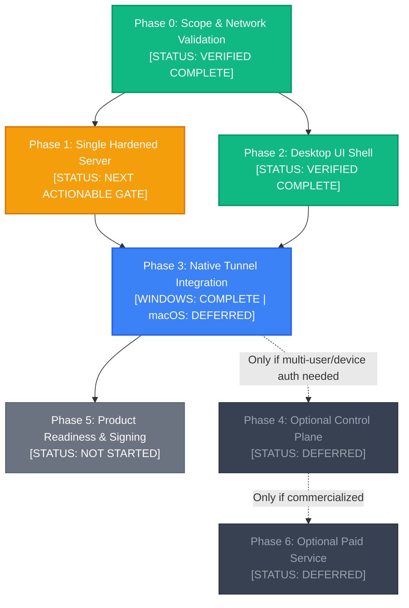

# FLUX VPN — Original Roadmap Reconciliation

**Status:** Authoritative Architectural & Phased Roadmap Audit (Post-Handshake Verification)  
**Project Root:** `E:\VPN`  
**Last Audit Date:** October 22, 2026  
**Sources of Truth:**
- [`docs/00_README.md`](file:///e:/VPN/docs/00_README.md) — Project Charter & Technical Decisions
- [`docs/01_REQUIREMENTS.md`](file:///e:/VPN/docs/01_REQUIREMENTS.md) — Functional (FR-1–23) & Non-Functional Requirements (NFR-1–10)
- [`docs/02_ARCHITECTURE.md`](file:///e:/VPN/docs/02_ARCHITECTURE.md) — Control vs. Data Plane Architecture & Flows
- [`docs/03_DESIGN.md`](file:///e:/VPN/docs/03_DESIGN.md) — State Machine, Component Responsibilities, UI Architecture
- [`docs/04_UI_THEME.md`](file:///e:/VPN/docs/04_UI_THEME.md) / [`docs/DESIGN-lamborghini.md`](file:///e:/VPN/docs/DESIGN-lamborghini.md) — Obsidian & Gold Design System
- [`docs/05_FOLDER_STRUCTURE.md`](file:///e:/VPN/docs/05_FOLDER_STRUCTURE.md) — Monorepo Layout
- [`docs/06_IMPLEMENTATION_PLAN.md`](file:///e:/VPN/docs/06_IMPLEMENTATION_PLAN.md) — Phased Build Order (Phase 0–6)
- [`docs/07_DATABASE_SCHEMA.md`](file:///e:/VPN/docs/07_DATABASE_SCHEMA.md) — Optional Minimal Schema
- [`docs/08_SECURITY_COMPLIANCE.md`](file:///e:/VPN/docs/08_SECURITY_COMPLIANCE.md) — Security Checklist & Pre-Launch Gates
- [`docs/test-results.md`](file:///e:/VPN/docs/test-results.md) — Verified Tunnel Benchmarks & Telemetry Evidence

---

## 1. Original Product Vision

FLUX is an encrypted, privacy-centric desktop VPN client for **Windows 10/11 and macOS**, connecting authorized users to a hardened Linux WireGuard server.

### Core Principles
1. **Separation of Control and Data Planes:** The data plane (encrypted WireGuard tunnel directly between client and VPN node) operates completely independently of the optional control plane (API/database). Existing tunnels must remain fully functional if the API goes offline.
2. **Local Key Custody:** In accordance with **FR-19**, client private keys are generated on the user's device and never transmitted to the backend or server.
3. **Truth in State Reporting:** In accordance with **FR-6** and **NFR-8**, the application never reports "Connected" or claims traffic is encrypted based solely on a running Windows service. The UI must distinguish between native service execution and verified cryptographic data-plane traffic.
4. **Honest Marketing & Privacy:** Rejects claims of "complete anonymity" or "guaranteed access to all blocked sites." Default configuration collects zero browsing history, destination URLs, or DNS query payloads (**NFR-7**).

---

## 2. Original Phased Roadmap (Phase 0–6)

The documented build order ([`docs/06_IMPLEMENTATION_PLAN.md`](file:///e:/VPN/docs/06_IMPLEMENTATION_PLAN.md)) defines strict sequential acceptance gates:



- **Phase 0 — Scope & Network Validation:** Confirm tunnel feasibility on test networks; measure latency/MTU; prove raw WireGuard routing using official clients before building custom code. *(Status: **Verified Complete** — Handshake established, 0% packet loss, 2ms avg RTT recorded in [`docs/test-results.md`](file:///e:/VPN/docs/test-results.md)).*
- **Phase 1 — Single Hardened Server:** Stand up one Ubuntu node; configure IP forwarding, firewall, DNS, and IPv6 behavior; record cost and transfer limits. *(Status: **Next Actionable Milestone**).*
- **Phase 2 — Desktop UI Shell:** Implement the React + TypeScript + Tailwind UI in Tauri 2 with a 7-state finite state machine, accessible status, and mocked tunnel adapter. *(Status: **Verified Complete**).*
- **Phase 3 — Native Tunnel Integration:** Integrate trusted OS-native WireGuard mechanisms (Windows SCM service observer/controller and macOS `NEPacketTunnelProvider`); test sleep/wake and network recovery. *(Status: **Windows Complete & Verified; macOS Deferred**).*
- **Phase 4 — Optional Control Plane (Deferred):** Add Node.js/Express API and PostgreSQL only if multi-user registration, dynamic device provisioning, or server selection is required.
- **Phase 5 — Product Readiness:** Code signing (Authenticode & Apple Developer ID), packaging (MSI/NSIS/DMG), automated CI/CD, backup drills, and third-party license notices.
- **Phase 6 — Optional Paid Service (Deferred):** Legal review, tax compliance, payment provider approval, and idempotent webhook subscription entitlements.

---

## 3. Mapping of the 16 Implementation Areas to Phases

The 16 functional areas established in the architectural analysis map directly into the original phased roadmap:

| Area | Functional Area Title | Target Phase | Current Status | Implementation Scope |
| :---: | :--- | :---: | :---: | :--- |
| **1** | Repository & Dev Environment Validation | **Phase 0** | **Verified Complete** | Monorepo layout, toolchains, build scripts, git hygiene. |
| **2** | Tauri Desktop Application Foundation | **Phase 2** | **Verified Complete** | Tauri 2 shell, IPC boundary, capabilities, window rules. |
| **3** | React, TypeScript & Tailwind CSS Setup | **Phase 2** | **Verified Complete** | Styling system, Obsidian & Gold tokens, typography. |
| **4** | Desktop UI Implementation | **Phase 2** | **Verified Complete** | Dashboard, ConnectButton, StatusIndicator, MetricsBar, Diagnostics. |
| **5** | VPN Integration Design & Technical Spike | **Phase 0** | **Verified Complete** | WireGuard baseline validation, handshake confirmed, latency recorded. |
| **6** | Windows VPN Integration | **Phase 3** | **Verified Complete** | Windows Service Control Manager (SCM), UAPI pipe reader, elevation. |
| **7** | macOS VPN Integration | **Phase 3** | **Not Started** | Apple Network Extension (`NEPacketTunnelProvider`), macOS IPC. |
| **8** | Connection State Management & Failure Handling | **Phase 3** | **Verified Complete** | 7-state finite state machine, SCM/UAPI sync, timeout guards. |
| **9** | Backend API Architecture & Implementation | **Phase 4** | **Optional / Deferred** | Node.js + Express + TypeScript control plane (Optional). |
| **10** | PostgreSQL Schema & Migrations | **Phase 4** | **Optional / Deferred** | Users, devices, servers tables, forward migrations (Optional). |
| **11** | Local Development Using Docker Compose | **Phase 1** | **Verified Complete** | Containerized WireGuard test server on UDP 51820. |
| **12** | Authentication & Device Management | **Phase 4** | **Optional / Deferred** | Device key registration, revocation, session auth (Optional). |
| **13** | AWS Deployment & Production Infrastructure | **Phase 1** | **Not Started** | Hardened Ubuntu VPS, UFW firewall, iptables NAT, Unbound DNS. |
| **14** | Security Testing & Privacy Controls | **Phase 3 / 5** | **Partially Complete** | Key scrubbing verified, ACLs active; leak tests pending full tunnel. |
| **15** | Automated Testing & CI/CD | **Phase 5** | **Not Started** | GitHub Actions workflows (`checks.yml`, `desktop-build.yml`). |
| **16** | Packaging, Signing & Release Preparation | **Phase 5** | **Not Started** | Windows Authenticode, Apple Notarization, NSIS/MSI/DMG bundles. |

---

## 4. Current Implementation Status & Supporting Evidence

### Classification Summary
- **Verified Complete:** 7 areas (Areas 1, 2, 3, 4, 5, 6, 8, 11)
- **Partially Complete:** 1 area (Area 14)
- **Not Started:** 4 areas (Areas 7, 13, 15, 16)
- **Optional / Deferred for MVP:** 3 areas (Areas 9, 10, 12, plus Phase 6)

---

### Detailed Status by Area

#### Area 1: Repository and Development Environment Validation
- **Classification:** **Verified Complete**
- **Phase:** Phase 0 (Prerequisite)
- **Evidence:**
  - Monorepo structure aligned matching [`docs/05_FOLDER_STRUCTURE.md`](file:///e:/VPN/docs/05_FOLDER_STRUCTURE.md): [`apps/desktop/`](file:///e:/VPN/apps/desktop), [`infra/`](file:///e:/VPN/infra), [`packages/`](file:///e:/VPN/packages), [`tests/`](file:///e:/VPN/tests).
  - Package identity set to `flux-desktop` in [`apps/desktop/package.json`](file:///e:/VPN/apps/desktop/package.json#L2).
  - Root workspace [`package.json`](file:///e:/VPN/package.json) orchestrates `dev:desktop`, `build:desktop`, and `test:desktop`.
  - Git hygiene verified; [`.gitignore`](file:///e:/VPN/.gitignore) actively protects `.conf`, `privatekey*`, `presharedkey*`, and client config archives.

#### Area 2: Tauri Desktop Application Foundation
- **Classification:** **Verified Complete**
- **Phase:** Phase 2
- **Evidence:**
  - Tauri 2 configured in [`apps/desktop/src-tauri/tauri.conf.json`](file:///e:/VPN/apps/desktop/src-tauri/tauri.conf.json) with bundle identifier `com.flux.vpn`.
  - Tauri capabilities locked down in [`capabilities/default.json`](file:///e:/VPN/apps/desktop/src-tauri/capabilities/default.json).
  - Native IPC handlers registered in [`src-tauri/src/lib.rs`](file:///e:/VPN/apps/desktop/src-tauri/src/lib.rs#L59-L67) (`get_tunnel_status`, `start_tunnel`, `stop_tunnel`, `verify_tunnel_connectivity`).

#### Area 3: React, TypeScript, and Tailwind CSS Setup
- **Classification:** **Verified Complete**
- **Phase:** Phase 2
- **Evidence:**
  - Tailwind CSS v4 configured via `@tailwindcss/vite` in [`apps/desktop/vite.config.ts`](file:///e:/VPN/apps/desktop/vite.config.ts).
  - Font Inter loaded via `@fontsource/inter` in [`apps/desktop/src/index.css`](file:///e:/VPN/apps/desktop/src/index.css).
  - Strict TypeScript models compiled with 0 errors via `npm run build` (`tsc && vite build`) in $< 1\text{ second}$.

#### Area 4: Desktop UI Implementation
- **Classification:** **Verified Complete**
- **Phase:** Phase 2
- **Evidence:**
  - Designed with Obsidian & Gold design system (`#000000` / `#FFC000`) per [`docs/DESIGN-lamborghini.md`](file:///e:/VPN/docs/DESIGN-lamborghini.md).
  - Key components implemented: [`Header.tsx`](file:///e:/VPN/apps/desktop/src/components/Header.tsx), [`StatusIndicator.tsx`](file:///e:/VPN/apps/desktop/src/components/StatusIndicator.tsx), [`ConnectButton.tsx`](file:///e:/VPN/apps/desktop/src/components/ConnectButton.tsx), [`ServerCard.tsx`](file:///e:/VPN/apps/desktop/src/components/ServerCard.tsx), [`MetricsBar.tsx`](file:///e:/VPN/apps/desktop/src/components/MetricsBar.tsx), [`DiagnosticsModal.tsx`](file:///e:/VPN/apps/desktop/src/components/DiagnosticsModal.tsx), and [`StateSimulator.tsx`](file:///e:/VPN/apps/desktop/src/components/StateSimulator.tsx).

#### Area 5: VPN Integration Design & Technical Spike
- **Classification:** **Verified Complete (Phase 0 Acceptance Satisfied)**
- **Phase:** Phase 0
- **Evidence:**
  - Local WireGuard server container `flux-wireguard-test` is active on `0.0.0.0:51820->51820/udp`.
  - Cryptographic handshake confirmed between Windows client service and Docker server.
  - Bidirectional packet counters verified: $1.20\text{ KiB} \rightarrow 13.08\text{ KiB RX}$, $1.02\text{ KiB} \rightarrow 12.70\text{ KiB TX}$.
  - Baseline ICMP ping benchmarks: 10/10 standard packets (0% loss, 2ms avg RTT) and 10/10 1000-byte packets (0% loss, 2ms avg RTT).
  - All Phase 0 measurements formally recorded in [`docs/test-results.md`](file:///e:/VPN/docs/test-results.md).

#### Area 6: Windows VPN Integration
- **Classification:** **Verified Complete**
- **Phase:** Phase 3
- **Evidence:**
  - SCM reader and lifecycle operations implemented in [`src-tauri/src/tunnel/windows.rs`](file:///e:/VPN/apps/desktop/src-tauri/src/tunnel/windows.rs).
  - Standard user read-only SCM queries require zero administrator elevation (`SC_MANAGER_CONNECT`, `SERVICE_QUERY_STATUS`).
  - Data-plane UAPI named pipe reader implemented in [`src-tauri/src/tunnel/verification.rs`](file:///e:/VPN/apps/desktop/src-tauri/src/tunnel/verification.rs).
  - Safely reads `\\.\pipe\WireGuard\flux` and `\\.\pipe\ProtectedPrefix\Administrators\WireGuard\flux`.
  - Key-scrubbing parser strips private keys; parses `last_handshake_time_sec`, `rx_bytes`, `tx_bytes`.
  - 30-second clock skew tolerance margin handles virtualized container/host clock jitter.

#### Area 7: macOS VPN Integration
- **Classification:** **Not Started**
- **Phase:** Phase 3
- **Evidence:**
  - Deferred to subsequent milestone. Windows development host has been prioritized.

#### Area 8: Connection State Management and Failure Handling
- **Classification:** **Verified Complete**
- **Phase:** Phase 3
- **Evidence:**
  - Authoritative 7-state finite state machine in [`apps/desktop/src/state/useVpn.ts`](file:///e:/VPN/apps/desktop/src/state/useVpn.ts).
  - Synchronized with Windows SCM via [`apps/desktop/src/state/useNativeTunnel.ts`](file:///e:/VPN/apps/desktop/src/state/useNativeTunnel.ts).
  - 15-second timeout guard prevents stuck `connecting` states.
  - **Zero-False-Protection Rule (NFR-8):** When service is running without an active handshake, UI reports `TUNNEL RUNNING` (`"Tunnel service active · Handshake pending"`) in warning amber `#FFCE3E`. The app **never** reports "Connected" or "Protected" solely on service execution.
  - Subtitle truthfully reports `"Tunnel active · Bidirectional traffic verified"`.
  - Automated tests passing: **28 Rust unit tests** (`cargo test`) and **20 TypeScript tests** (`npm test`).

#### Area 9: Backend API Architecture (Optional Control Plane)
- **Classification:** **Optional / Deferred**
- **Phase:** Phase 4
- **Evidence:**
  - Explicitly deferred per [`docs/00_README.md`](file:///e:/VPN/docs/00_README.md#L37) and [`docs/02_ARCHITECTURE.md`](file:///e:/VPN/docs/02_ARCHITECTURE.md#L50). Not required for technical MVP.

#### Area 10: PostgreSQL Schema & Database Migrations
- **Classification:** **Optional / Deferred**
- **Phase:** Phase 4
- **Evidence:**
  - Logical schema designed in [`docs/07_DATABASE_SCHEMA.md`](file:///e:/VPN/docs/07_DATABASE_SCHEMA.md); database integration deferred until multi-user accounts are introduced.

#### Area 11: Local Development Using Docker Compose
- **Classification:** **Verified Complete**
- **Phase:** Phase 1
- **Evidence:**
  - Container defined in [`infra/server/local-wireguard/docker-compose.yml`](file:///e:/VPN/infra/server/local-wireguard/docker-compose.yml) running on `0.0.0.0:51820->51820/udp`.
  - Active server configuration in `infra/server/local-wireguard/config/` with verified server public key `LBW3vxr...S1U=`.
  - Registered peer matches client public key `LdAUvKmB...`.
  - Local containerized data plane fully verified for Phase 0 technical testing.

#### Area 12: Authentication and Device Management
- **Classification:** **Optional / Deferred**
- **Phase:** Phase 4
- **Evidence:**
  - Deferred in MVP. Client currently manages credentials locally on the Windows host.

#### Area 13: AWS Deployment and Production Infrastructure
- **Classification:** **Not Started (Next Actionable Milestone)**
- **Phase:** Phase 1
- **Evidence:**
  - Directory [`infra/aws/`](file:///e:/VPN/infra/aws) contains `.gitkeep`. Production VPS provisioning is the immediate next step now that Phase 0 local technical validation is complete.

#### Area 14: Security Testing and Privacy Controls
- **Classification:** **Partially Complete**
- **Phase:** Phase 3 / 5
- **Evidence:**
  - Client credentials protected with Windows ACLs (`icacls` restricted to user and SYSTEM).
  - Git hygiene verified (`.gitignore` excludes all keys and client configs).
  - UAPI parser explicitly ignores private keys and passes only byte counters and handshake timestamps.
  - Split-tunnel routing verified via `Get-NetRoute`: only `10.13.13.0/24` routes to `flux`; `0.0.0.0/0` stays on physical Wi-Fi.
  - Full DNS, IPv4, and IPv6 leak tests cannot be conducted until full tunnel routing is enabled on a cloud node.

#### Area 15: Automated Testing and CI/CD
- **Classification:** **Not Started**
- **Phase:** Phase 5
- **Evidence:**
  - Directory [`.github/workflows/`](file:///e:/VPN/.github/workflows) contains `.gitkeep`. Workflows for automated multi-platform builds and testing have not yet been populated.

#### Area 16: Windows & macOS Packaging, Signing, and Release Preparation
- **Classification:** **Not Started**
- **Phase:** Phase 5
- **Evidence:**
  - Code signing certificates and release bundle generators (NSIS/MSI) not yet configured.

---

## 5. Requirements That Remain Incomplete

| Requirement ID | Description | Blocking Phase | Current Gap |
| :--- | :--- | :---: | :--- |
| **FR-10 / FR-11** | Encrypted tunnel routing & NAT forwarding | **Phase 1** | Local setup strictly uses split tunneling (`10.13.13.0/24`). Full default gateway routing (`0.0.0.0/0`) requires Phase 1 cloud node with `iptables` NAT masquerade. |
| **FR-12 / NFR-8** | Explicit IPv4/IPv6 leak prevention & safe failure | **Phase 1** | Full-tunnel leak tests require Unbound recursive DNS resolver and server-side IPv6 blocking (`net.ipv6.conf.all.disable_ipv6 = 1`). |
| **FR-1** | macOS Client Support | **Phase 3** | macOS `NEPacketTunnelProvider` extension is not yet implemented (requires macOS workstation). |
| **FR-9** | Kill switch implementation | **Phase 3** | Kill switch is not yet implemented (correctly deferred until full tunnel routing is stable). |
| **NFR-1 / NFR-2** | WAN Latency and throughput benchmarks | **Phase 1** | Local loopback latency measured (2ms avg); real WAN throughput across the internet pending Phase 1 deployment. |
| **NFR-9** | Signed releases and update verification | **Phase 5** | Authenticode and Apple Developer ID signing certificates not configured. |

---

## 6. Dependencies and Blockers

```text
┌────────────────────────────────────────────────────────┐
│ Phase 0 Validation: [VERIFIED COMPLETE]                │
│  - Handshake established & verified                    │
│  - 0% packet loss, 2ms avg RTT                         │
│  - 48 automated unit tests pass (28 Rust + 20 TS)      │
│  - Zero-false-protection UI reporting enforced         │
└───────────────────────────┬────────────────────────────┘
                            │
                            ▼
┌────────────────────────────────────────────────────────┐
│ Phase 1: Single Hardened Cloud Node [ACTIONABLE NEXT]  │
│  - Provision Ubuntu 24.04 VPS                          │
│  - Configure UFW, sysctl IP forwarding, iptables NAT   │
│  - Deploy Unbound recursive DNS on 10.13.13.1          │
│  - Execute full-tunnel routing & leak tests            │
└───────────────────────────┬────────────────────────────┘
                            │
            ┌───────────────┴───────────────┐
            ▼                               ▼
┌─────────────────────────┐     ┌────────────────────────┐
│ macOS Integration (P3)  │     │ Product Release (P5)   │
│ [BLOCKER: macOS machine]│     │ [BLOCKER: Certs/CI/CD] │
└─────────────────────────┘     └────────────────────────┘
```

1. **Resolved Blocker — Local Handshake & Data Plane:**
   - The cryptographic handshake between the Windows client service and the local Docker server has been **resolved and verified**.
   - Bidirectional traffic flow, live UAPI parsing, and baseline latency are confirmed.
2. **Actionable Gate — Cloud Infrastructure Provisioning:**
   - Full internet routing (`AllowedIPs = 0.0.0.0/0`) and DNS leak prevention cannot be executed against the local Docker test container because it lacks public egress NAT.
   - Provisioning a single Ubuntu 24.04 VPS in Phase 1 is the next required step.
3. **Platform Blocker — macOS Toolchain:**
   - Building and testing the macOS `NEPacketTunnelProvider` requires a macOS workstation and an Apple Developer Account.
4. **Release Blocker — Code Signing:**
   - Packaging production installers requires an Authenticode certificate on Windows to prevent SmartScreen warnings.

---

## 7. Initial Desktop VPN vs. Optional Commercial Subscription Service

A clean architectural, operational, and legal boundary separates the core technical VPN from the commercial subscription service:

| Feature / Domain | Initial Desktop VPN (Core MVP) | Optional Commercial Service (Phase 4 & 6) |
| :--- | :--- | :--- |
| **Primary Goal** | Establish a verified, encrypted tunnel between a client and a hardened server. | Monetize VPN access for multiple external subscribers. |
| **Included Phases** | **Phase 0, Phase 1, Phase 2, Phase 3, Phase 5** | **Phase 4, Phase 6** |
| **Infrastructure** | Standalone Linux WireGuard node + Tauri desktop app. | Node.js API + PostgreSQL database + Redis worker + WireGuard nodes. |
| **User Management** | Static, pre-provisioned peer keys; zero accounts; no database. | User accounts, hashed credentials, session tokens, device revocation. |
| **Client Key Handling** | Client generates and stores private key locally; never sent to server. | Client generates key locally; public key registered via authenticated API. |
| **Billing & Payments** | None. Completely excluded from MVP. | Stripe/payment processor integration, webhooks, tax compliance, refunds. |
| **Observability** | OS service status + local WireGuard UAPI pipe counters. | Centralized server metrics, node capacity heartbeats, abuse rate-limiting. |
| **Compliance Focus** | Network acceptable-use compliance and data minimization. | Legal review (CERT-In / Indian VPN directives), terms of service, payment audits. |

---

## 8. Next Unfinished Task in the Original Plan

In strict accordance with the build order in [`docs/00_README.md`](file:///e:/VPN/docs/00_README.md#L32) and the acceptance criteria in [`docs/06_IMPLEMENTATION_PLAN.md`](file:///e:/VPN/docs/06_IMPLEMENTATION_PLAN.md#L17):

### **Next Milestone: Phase 1 — Single Hardened Server Deployment (No Custom UI Needed)**

Now that Phase 0 acceptance criteria have passed:
1. **Prerequisite:** Local tunnel verified, 0% packet loss documented, 48 automated tests passing, production build succeeding.
2. **Objective:** Provision and harden one standalone Ubuntu 24.04 VPS node to serve as the external production WireGuard gateway.
3. **Acceptance Criteria for Phase 1:**
   - Ubuntu 24.04 VPS provisioned with SSH key authentication only (no root password).
   - Kernel packet forwarding enabled (`sysctl net.ipv4.ip_forward = 1`).
   - IPv6 explicitly disabled or blocked (`net.ipv6.conf.all.disable_ipv6 = 1`) to eliminate IPv6 leak surface (FR-12).
   - UFW firewall active: default-deny incoming, allowing only UDP 51820 and restricted SSH.
   - `iptables` NAT `MASQUERADE` active on the egress network interface (`eth0`).
   - Unbound recursive DNS resolver running on `10.13.13.1:53` with DNSSEC validation, zero logging, and access restricted to `10.13.13.0/24` (NFR-5, NFR-7).
   - Client connects with `AllowedIPs = 0.0.0.0/0`, public IP changes to VPS IP, and formal DNS/IPv6 leak tests pass.
